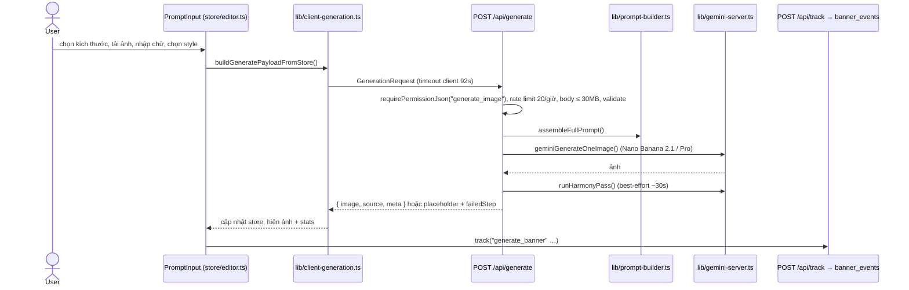
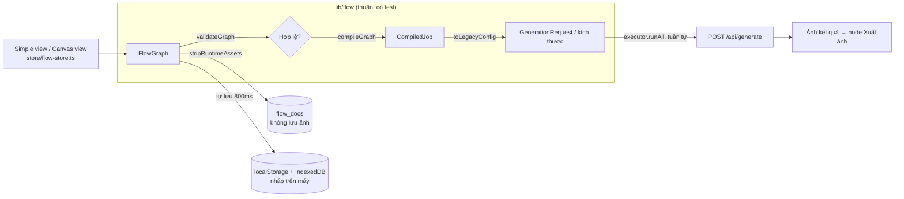
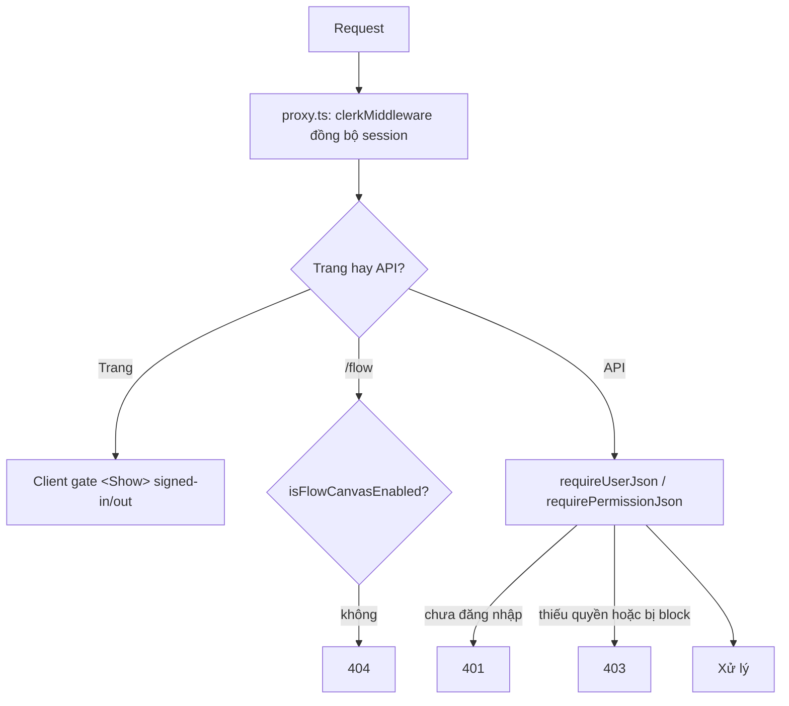

# Onboarding — làm quen dự án trong 1–2 ngày

Tài liệu dành cho người mới. Đọc theo thứ tự từ trên xuống: mỗi mục trả lời một câu hỏi và trỏ tới doc chi tiết. Khi doc chi tiết và code mâu thuẫn, **code đúng** — hãy sửa doc trong cùng PR.

## 1. Dự án là gì

**zVas Banner AI** (tên package `ai-banner-generator`): công cụ nội bộ tạo banner quảng cáo bằng AI. User tải ảnh sản phẩm/logo, nhập chữ (headline, sub, CTA) và chọn phong cách; server gọi **Google Gemini** (Nano Banana 2.1 mặc định) vẽ cả banner, sau đó chạy thêm một lượt "harmony pass" để ánh sáng/màu hài hoà. Có hai giao diện cùng dùng một pipeline:

| Giao diện | URL | Dành cho | Trạng thái |
| --- | --- | --- | --- |
| **Form** (editor) | `/` | Mọi user đã đăng nhập | Giao diện chính |
| **Chế độ nâng cao** (Flow canvas) | `/flow`, hướng dẫn `/flow/guide` | User được bật cờ `FLOW_CANVAS` | Beta, sẽ thay form khi được duyệt (SPEC T6.5) |

Ngoài ra: dashboard analytics + quản trị user (`/dashboard`), quản lý phiên đăng nhập (`/account/sessions`).

## 2. Lộ trình đọc

| Thứ tự | Đọc | Mục đích |
| --- | --- | --- |
| 1 | File này | Bức tranh tổng + luồng chính |
| 2 | [architecture.md](./architecture.md) | Stack, thư mục, luồng tạo ảnh rút gọn |
| 3 | [workflow.md](./workflow.md) | Cài `.env.local`, Clerk, Postgres, checklist thử tay |
| 4 | [frontend.md](./frontend.md) → [backend.md](./backend.md) | UI/state; route, RBAC, Gemini, bảo mật |
| 5 | [api.md](./api.md) | Tra cứu contract khi sửa route |
| 6 | [flow/SPEC.md](./flow/SPEC.md) mục 1–7 | Bắt buộc trước khi đụng `/flow`, `lib/flow*`, `components/flow` |
| 7 | [deploy.md](./deploy.md) | Khi cần đưa lên Vercel |

Tài liệu **lịch sử / tham khảo** (không mô tả hệ thống hiện tại, đừng làm theo): `docs/flow/STEP-0.md`, `docs/flow/STEP-1.md`, `docs/flow/QUESTIONS.md` (nhật ký quyết định Q1–Q17), SPEC mục 10 (nhật ký phiên), `docs/roadmap/` (đề xuất chưa làm), `openspec/changes/archive/`. Spec hành vi đang hiệu lực của marketing brief nằm ở `openspec/specs/`.

## 3. Chạy được trên máy (≈15 phút)

```bash
npm install
cp .env.local.example .env.local
```

Điền tối thiểu vào `.env.local` (chi tiết: [workflow.md § Cấu hình](./workflow.md#cấu-hình-file-envlocal)):

| Biến | Bắt buộc? | Ghi chú |
| --- | --- | --- |
| `GEMINI_API_KEY` | Có | Thiếu → generate trả ảnh placeholder |
| `NEXT_PUBLIC_CLERK_PUBLISHABLE_KEY`, `CLERK_SECRET_KEY` | Có | Instance Clerk dev; bật Username + Password, xin admin tạo user |
| `DATABASE_URL` | Nên có | Cần cho analytics, dashboard, lưu dự án Flow, cài đặt liên hệ |
| `FLOW_CANVAS=on` | Nếu làm Flow | Mặc định `off` → `/flow` trả 404 |
| `ADMIN_EMAIL` | Tuỳ | Email của bạn → luôn là admin, vào được dashboard |

```bash
psql "$DATABASE_URL" -f db/banner_events.sql   # bảng duy nhất cần tạo tay; flow_docs, flow_events, app_settings tự tạo
npm run dev                                     # http://localhost:3000
```

Kiểm tra trước khi commit (chưa có script `npm test`):

```bash
npx vitest run       # toàn bộ test (37 file, ~2s)
npx tsc --noEmit
npm run lint
```

## 4. Bản đồ code

```
app/
  (editor)/page.tsx          Form "/" (server: đọc cờ Flow + thông tin liên hệ)
  (studio)/flow/             "/flow" và "/flow/guide" (server: auth + cờ, tắt → 404)
  dashboard/, account/sessions/, sign-in/
  api/**/route.ts            Toàn bộ backend (Route Handlers, Node runtime)
components/
  layout/ prompt/ canvas/ assets/   UI form
  flow/                      UI Flow (FlowCanvas, simple/, inspector/, nodes/, guide/)
  dashboard/ account/ auth/ ui/     ui/ = component shadcn
store/
  editor.ts                  Zustand của form (không persist)
  flow-store.ts, flow-history.ts    Zustand của Flow (graph + undo/redo)
lib/
  prompt-builder.ts          Ghép prompt (dùng chung form + Flow)
  gemini-server.ts           Gọi Gemini: generate, harmony, edit, enhance
  client-generation.ts       Client gọi /api/generate (timeout 92s)
  validate-generation.ts     Parse/validate GenerationRequest phía server
  authz.ts, require-user.ts  RBAC + gate cho route
  request-limits.ts, generation-rate-limit.ts   Rate limit + giới hạn body
  flags.ts, flow-rollout.ts  Cờ FLOW_CANVAS
  flow/                      Domain Flow THUẦN (không React/Next/Zustand): schema, node, validate, compiler, executor, template, persistence
  flow-ui/                   Phần Flow cần trình duyệt (React Flow adapter, nháp IndexedDB)
  flow-server/               Phần Flow phía server (DB, brand-fetch, suggest-copy)
  types.ts                   Type gốc: GenerationRequest, CanvasConfig, UploadedAsset, StyleControls…
db/*.sql                     Schema Postgres (tham khảo / chạy tay)
proxy.ts                     Middleware Clerk (Next 16 đổi tên middleware.ts → proxy.ts)
next.config.mjs              Security headers + CSP
```

## 5. Luồng chính: tạo banner từ form



Sau đó user có thể: **chỉnh sửa** ảnh (`/api/edit-image`), tạo **biến thể kích thước** (gọi lại `/api/generate` với `layoutAdaptationFromBanner` = ảnh gốc, luôn Nano Banana 2.1), **xuất** PNG/JPG qua Canvas API (`lib/export.ts`).

File nên mở theo thứ tự để hiểu luồng: `components/prompt/prompt-input/use-prompt-input-actions.ts` → `lib/client-generation.ts` → `app/api/generate/route.ts` → `lib/prompt-builder.ts` (`assembleFullPrompt`) → `lib/gemini-server.ts`.

## 6. Luồng Flow canvas (`/flow`)

Graph (node + dây) là nguồn dữ liệu duy nhất; Flow **không có pipeline AI riêng** — nó biên dịch graph về đúng `GenerationRequest` mà form gửi.



- 9 loại node (`lib/flow/node-definitions.ts`): Ảnh sản phẩm, Ảnh tham chiếu, Brief, Text, Brand kit, Kích thước, Phong cách, **Tạo banner** (executor duy nhất, 2 lượt AI / kích thước), Xuất ảnh.
- 5 template (`lib/flow/template/defaults.ts`) + "Canvas trống" (`?template=blank`). **Đơn giản** = form sinh từ `exposed` của template; **Canvas** = toàn bộ graph.
- Kích thước thứ hai trở đi được dựng lại từ ảnh kích thước đầu (giống "Biến thể kích thước" của form).
- Chế độ **Ghép layer** (composed) đã gỡ 2026-10-20 — mọi đoạn docs/log nhắc layout engine, Tạo nền, Compose, `/api/flow/generate-background` là lịch sử. Dữ liệu cũ được `convertComposedDoc` chuyển tự động.
- Từ form, nút **Chế độ nâng cao** (`components/layout/OpenInCanvasButton.tsx`) chuyển state form → graph (`fromLegacyConfig` → `decompileJob`).

Quy tắc bất biến khi sửa Flow (đầy đủ ở [SPEC § 2](./flow/SPEC.md#2-nguyên-tắc-không-được-vi-phạm)): `lib/flow/` không import React/Next/Zustand; ảnh sản phẩm luôn gửi `strictPreserveMode = true`; không sửa pipeline cũ (route, prompt-builder, gemini-server, export, client-generation) khi chưa được duyệt.

## 7. Auth, quyền và cờ



| Role | Quyền |
| --- | --- |
| `editor` (mặc định) | `generate_image` |
| `mod` | + `view_dashboard`, `manage_roles` (không đụng được admin) |
| `admin` | + `block_user`, `delete_user`, `manage_settings` |

Role lưu trong Clerk `privateMetadata.role`; cache 60s. Cờ Flow: `FLOW_CANVAS` = `off | allowlist | rollout | on` (+ allowlist, %, salt, denylist).

## 8. Dữ liệu

| Bảng | Ghi bởi | Tạo bảng |
| --- | --- | --- |
| `banner_events` | `/api/track`, audit admin | **Chạy tay** `db/banner_events.sql` (index tự bổ sung) |
| `flow_docs` | `/api/flow/docs` (dự án Flow, tối đa 200/user, không có ảnh) | Tự tạo lần gọi đầu |
| `flow_events` | `/api/flow/track` | Tự tạo |
| `app_settings` | `/api/settings/contact` (liên hệ cấp tài khoản) | Tự tạo |

Ảnh không được lưu ở server: ảnh tạo ra chỉ sống trên trình duyệt (store / IndexedDB nháp).

## 9. Làm việc hằng ngày

- **Thêm route API**: gate bằng `requirePermissionJson`/`requireUserJson`, đọc body bằng `readJsonWithSizeLimit`, có rate limit nếu gọi AI, không trả raw error ra client; cập nhật bảng route ở [backend.md](./backend.md) và contract ở [api.md](./api.md).
- **Thêm domain ngoài ở client** (script/fetch/ảnh/iframe): thêm vào CSP trong `next.config.mjs`, nếu không trình duyệt chặn im lặng.
- **Thêm event analytics**: khai báo type trong `lib/analytics-events.ts` trước.
- **Sửa Flow**: làm theo SPEC § 6 (một task/lần, test + `tsc` xanh, commit `feat(flow): …`, ghi nhật ký SPEC § 10).
- **Copy UI**: tiếng Việt, ngắn; dùng "Tạo" (không "Sinh"); gọi Flow là "Chế độ nâng cao", "dự án" thay "project".
- **Commit**: Conventional Commits (`feat(scope): …`, `fix(…)`, `docs(…)`), xem `git log`.

## 10. Bẫy hay gặp

| Triệu chứng | Nguyên nhân / cách xử lý |
| --- | --- |
| Chỉ thấy ảnh placeholder | Thiếu/sai `GEMINI_API_KEY` hoặc hết quota; raw error chỉ có trong log server |
| `/flow` 404 | `FLOW_CANVAS` đang `off` hoặc user không thuộc allowlist/rollout |
| 409 `user_settings_invalid` khi đăng nhập | Clerk chưa bật Username + Password ([workflow.md](./workflow.md)) |
| 429 khi thử nhiều | Rate limit 20/giờ/user, in-memory → restart dev server |
| Console báo lỗi CSP | Domain mới chưa có trong `next.config.mjs` |
| Hydration warning `bis_skin_checked` | Extension trình duyệt (Bitwarden…) |
| Mở lại dự án Flow mà node ảnh báo "Cần tải lại ảnh" | Đúng thiết kế: dự án không lưu ảnh (Q7B) |
| Dashboard 403 | Role `editor`; đặt `privateMetadata.role` hoặc `ADMIN_EMAIL` |

## 11. Bài khởi động gợi ý

1. Chạy app, tạo một banner ở form, mở DevTools xem request `/api/generate` và hộp stats.
2. Đặt breakpoint/log trong `assembleFullPrompt` để xem prompt thật gửi Gemini.
3. Bật `FLOW_CANVAS=on`, mở `/flow`, đổi qua lại Đơn giản ↔ Canvas; đọc `lib/flow/__tests__/roundtrip.test.ts` để hiểu graph ↔ request.
4. Đọc `lib/flow/__tests__/rules.test.ts` — các luật bất biến được khoá bằng test.
